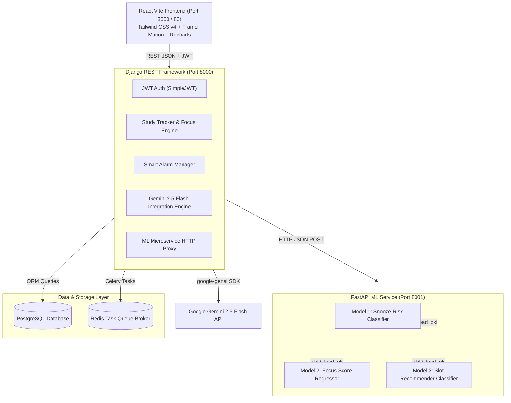

# AI-Powered Smart Study and Alarm Management System

A production-style full-stack application integrating **Django REST Framework**, **FastAPI**, **React (Vite + Tailwind CSS v4)**, **PostgreSQL**, **Redis**, **Scikit-Learn Machine Learning models**, and **Google Gemini 2.5 Flash Generative AI**.

---

## 🌟 Key Features

### 🧠 1. Machine Learning & Predictive Analytics Microservice (FastAPI)
- **Model 1: Snooze Risk Predictor (`RandomForestClassifier`)** — Evaluates historical wake logs and sleep duration to estimate snooze probability ($0.0 - 1.0$) and dynamically enforces math puzzle dismissals for high-risk alarms (Accuracy: 94.00%).
- **Model 2: Focus Score Estimator (`RandomForestRegressor`)** — Estimates post-session cognitive focus scores ($0.0 - 100.0$) using duration, break frequency, time of day, and tab switches ($R^2 = 0.9417$, MAE = 4.16).
- **Model 3: Optimal Study Slot Recommender (`RandomForestClassifier`)** — Recommends optimal study times (Morning, Afternoon, Evening, Night) based on subject type and historical focus trends.

### 🤖 2. Google Gemini 2.5 Flash Generative AI Engine
- **AI Study Plan Generator**: Generates day-by-day exam schedules from syllabus topics and target dates with strict JSON schema validation.
- **AI Notes Summarizer**: Converts textbook passages and study notes into executive summaries, key bullet points, and core concepts.
- **AI MCQ Quiz Generator**: Auto-generates multiple-choice quizzes with options, answer keys, and explanations.
- **AI Academic Doubt Chatbot**: Subject-aware conversational assistant for instant academic doubt solving.

### ⏰ 3. Smart Alarm System & Web Audio Synthesizer
- Progressive tone synthesis using HTML5 Web Audio API (`AudioContext`, `OscillatorNode`, `GainNode`).
- Mental math puzzle modal (Framer Motion) forced when ML predicts high snooze risk.
- Automatic wake log telemetry sent to backend.

### ⏱️ 4. Focus Session Tracker & Tab Distraction Detection
- Real-time Pomodoro study timer with pause/resume and break counter.
- HTML5 Page Visibility API (`visibilitychange` event) tracking tab switches and off-screen distractions.
- Rule-based continuous focus score computation engine.

### 🎴 5. Spaced Repetition Flashcards (SuperMemo SM-2)
- Implements the SuperMemo SM-2 algorithm to schedule memory revision dates based on quality ratings ($0 - 5$).
- Interactive 3D flip card UI in React.

### 📊 6. Interactive Analytics & Gamification
- Recharts visualizations: 7-Day Focus Score Trend, Sleep vs. Study Hours correlation, and Subject Time Distribution.
- Automated gamification engine rewarding streak milestones and focus accomplishments with badges.

---

## 🏗️ System Architecture



---

## 🛠️ Technology Stack

| Layer | Technology |
| :--- | :--- |
| **Frontend** | React 19, Vite, Tailwind CSS v4, Framer Motion, Recharts, Lucide Icons, Axios |
| **Backend API** | Python 3.11, Django 5.1, Django REST Framework, SimpleJWT Authentication |
| **ML Microservice** | FastAPI, Uvicorn, Scikit-Learn, Joblib, NumPy, Pandas |
| **GenAI Engine** | Google Gemini 2.5 Flash (`google-genai` SDK) |
| **Database** | PostgreSQL 16 / SQLite fallback |
| **Task Queue** | Celery 5.4, Redis 7 |
| **Containerization** | Docker, Docker Compose, Nginx |

---

## 🚀 Quickstart Guide

### Option 1: Docker Compose (Recommended)

1. Clone the repository:
   ```bash
   git clone https://github.com/your-username/AI-SmartStudy_AlarmSystem.git
   cd AI-SmartStudy_AlarmSystem
   ```
2. Start all services:
   ```bash
   docker-compose up --build
   ```
3. Open your browser:
   - Frontend: `http://localhost:3000`
   - Django REST API: `http://localhost:8000/api/`
   - FastAPI ML Service Docs: `http://localhost:8001/docs`

---

### Option 2: Manual Local Setup

#### 1. Backend Setup (Django REST Framework)
```bash
cd backend
python -m venv venv
venv\Scripts\activate   # Windows
pip install -r requirements.txt
python manage.py migrate
python manage.py runserver 8000
```

#### 2. ML Microservice Setup (FastAPI)
```bash
cd ml-service
python -m venv venv
venv\Scripts\activate   # Windows
pip install -r requirements.txt
uvicorn main:app --host 0.0.0.0 --port 8001 --reload
```

#### 3. Frontend Setup (React Vite)
```bash
cd client
npm install
npm run dev
```

---

## 🧪 Running Unit & Integration Tests

### Django REST Backend Unit Tests:
```bash
cd backend
python manage.py test
```

### FastAPI Microservice Pytest Suite:
```bash
cd ml-service
pytest
```

---

## 📜 API Endpoint Reference

| Method | Endpoint | Description |
| :--- | :--- | :--- |
| `POST` | `/api/auth/register/` | Register new user account |
| `POST` | `/api/auth/login/` | Authenticate & acquire JWT access/refresh tokens |
| `GET` | `/api/alarms/` | List user alarms |
| `POST` | `/api/alarms/predict/snooze-risk/` | Proxy prediction request to FastAPI Snooze Risk Model |
| `POST` | `/api/study/session/start/` | Initialize live study session timer |
| `POST` | `/api/study/session/end/` | Finalize study session & compute focus score |
| `GET` | `/api/study/analytics/dashboard/` | Return Recharts analytics data & unlocked badges |
| `POST` | `/api/ai/generate-plan/` | Generate Gemini AI day-wise study schedule |
| `POST` | `/api/ai/summarize-notes/` | Summarize notes using Gemini 2.5 Flash |
| `POST` | `/api/ai/generate-quiz/` | Auto-generate multiple-choice quiz questions |
| `POST` | `/api/ai/chatbot/` | Academic doubt-solving AI tutor |
| `POST` | `/api/ai/flashcards/<id>/review/` | Submit SM-2 spaced repetition card review rating |

---

## 📄 License
Distributed under the MIT License. See `LICENSE` for more information.
